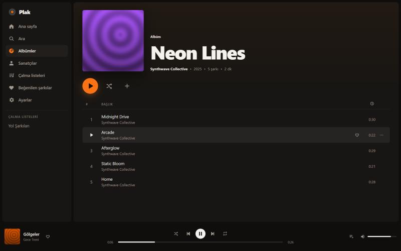
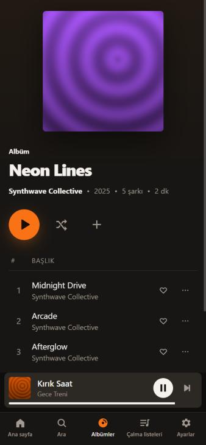

<div align="center">


# Plak

**Your music, your server.** A self-hosted music streaming server with a fast, beautiful web player.

[Türkçe](README.tr.md) · [Learn how it works (TR)](docs/OGREN.md) · [Contributing](CONTRIBUTING.md)



</div>

Plak turns a folder of music files into a personal streaming service. Install it on your PC, a NAS, a Raspberry Pi or a small VPS, point it at your music, and listen from any browser on your phone, tablet or laptop.

Plak ships no music and contacts no third-party service. Your library and your listening history stay on your machine.

## Features

- **Spotify-style web player:** albums, artists, search, queue, shuffle, repeat, liked songs and playlists.
- **Works on phones:** responsive layout with a bottom navigation bar. Lock-screen and media-key controls through the Media Session API.
- **Lossless friendly:** streams FLAC, MP3, AAC/M4A, Ogg/Opus and WAV as they are, without re-encoding. Seeking works through HTTP range requests.
- **Smart scanner:** reads tags and embedded artwork, picks up `cover.jpg` and `folder.jpg`, and rescans only the files that changed.
- **Turkish-aware search and sorting:** `sarki` finds `Şarkı`, and lists sort `Ç` after `C` and `İ` after `I`.
- **Family accounts:** each person gets their own playlists, likes and history. The first account becomes the admin.
- **Tiny footprint:** two runtime dependencies (Fastify and music-metadata). The database is SQLite built into Node.js, so nothing has to be compiled.
- **Safe by default:** scrypt password hashing, hashed session tokens, HttpOnly cookies, login rate limiting and a strict Content Security Policy.
- **English and Turkish interface.**



## Quick start

You need [Node.js 24](https://nodejs.org) or newer.

```bash
git clone https://github.com/OWNER/plak.git
cd plak
npm install
npm run build
PLAK_MUSIC_DIR=/path/to/your/music npm start
```

On Windows PowerShell:

```powershell
$env:PLAK_MUSIC_DIR = "D:\Music"
npm start
```

Open <http://localhost:4747> and create your admin account. The first scan starts automatically.

No music at hand? `npm run demo-library` writes 12 small, synthesized, copyright-free tracks into `./music`.

### Docker

```bash
docker compose up -d
```

Edit the `./music:/music:ro` line in `docker-compose.yml` to point at your music folder first.

<br clear="right" />

## Configuration

Plak is configured with environment variables.

| Variable | Default | Description |
| --- | --- | --- |
| `PLAK_MUSIC_DIR` | `./music` | Folder that holds your music. Subfolders are scanned. |
| `PLAK_DATA_DIR` | `./data` | Database and cached cover art. Back this folder up. |
| `PLAK_PORT` | `4747` | HTTP port. |
| `PLAK_HOST` | `0.0.0.0` | Interface to listen on. Use `127.0.0.1` to allow only this machine. |
| `PLAK_SCAN_INTERVAL` | `60` | Minutes between automatic rescans. `0` turns them off. |
| `PLAK_SESSION_DAYS` | `30` | How long a sign-in stays valid. |
| `PLAK_TRUST_PROXY` | `false` | Set to `true` behind a reverse proxy (Caddy, nginx) so HTTPS is detected. |

### Listening outside your home

Do not open port 4747 on your router. Use one of these instead:

- **[Tailscale](https://tailscale.com)**: install it on the server and your phone, then open `http://<server-name>:4747`. This is the easiest option.
- **A reverse proxy with HTTPS**, such as [Caddy](https://caddyserver.com): `caddy reverse-proxy --from music.example.com --to localhost:4747`, with `PLAK_TRUST_PROXY=true`.

## Organizing your music

Plak reads the tags inside your files, so the folder layout is up to you. This layout works well:

```
Music/
└── Artist/
    └── Album (Year)/
        ├── cover.jpg
        ├── 01 First Song.flac
        └── 02 Second Song.flac
```

Files without tags still show up: the file name becomes the title and the folder name becomes the album. [MusicBrainz Picard](https://picard.musicbrainz.org) can tag a messy library automatically.

## Development

```bash
npm install
npm run demo-library
npm run dev       # API on :4747 with auto-restart, UI on :5173 with hot reload
npm test          # API and unit tests
npm run typecheck
```

The project is a small npm workspace:

```
server/   Fastify API, scanner and SQLite database (TypeScript, run directly by Node)
web/      React + Vite single-page player
scripts/  Dev runner and demo library generator
docs/     Guides and screenshots
```

[docs/OGREN.md](docs/OGREN.md) walks through the whole code base step by step (in Turkish).

## Roadmap

- [ ] Subsonic API, so existing mobile apps (Symfonium, Substreamer, DSub) can connect
- [ ] Transcoding with ffmpeg for formats browsers cannot play, and for lower bandwidth on mobile data
- [ ] One-click Windows installer and system tray icon
- [ ] Synced lyrics from `.lrc` files
- [ ] Smart playlists and "play something similar" based on local audio analysis
- [ ] Offline downloads in the web app (PWA)
- [ ] Keep playlists when files are moved or renamed

Ideas and pull requests are welcome. See [CONTRIBUTING.md](CONTRIBUTING.md).

## License

[MIT](LICENSE) © SolidCode
