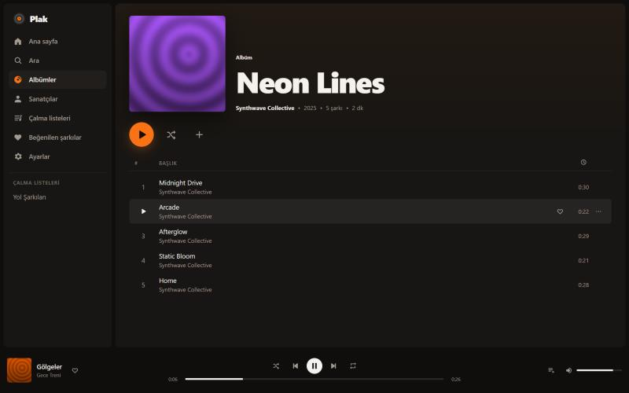

<div align="center">


# Plak

**Müziğin senin, sunucun senin.** Kendi bilgisayarına kurduğun müzik yayın sunucusu ve şık bir web çalar.

[English](README.md) · [Nasıl çalıştığını öğren](docs/OGREN.md) · [Katkıda bulun](CONTRIBUTING.md)



</div>

Plak, müzik dosyalarının bulunduğu bir klasörü kişisel bir müzik servisine çevirir. Bilgisayarına, NAS cihazına, Raspberry Pi'ye ya da küçük bir sunucuya kurarsın, müzik klasörünü gösterirsin. Sonra telefondan, tabletten ya da bilgisayardan tarayıcıyla dinlersin.

Plak'ın içinde hiç müzik yoktur ve hiçbir dış servise bağlanmaz. Kitaplığın ve dinleme geçmişin kendi cihazında kalır.

## Özellikler

- **Spotify benzeri çalar:** Albümler, sanatçılar, arama, sıra, karıştırma, tekrar, beğenilen şarkılar ve çalma listeleri.
- **Telefona uygun:** Alt menülü mobil görünüm. Kilit ekranından ve kulaklık tuşlarından kontrol edilebilir.
- **Kayıpsız ses:** FLAC, MP3, AAC/M4A, Ogg/Opus ve WAV dosyalarını dönüştürmeden yayınlar. Şarkının istediğin yerine atlayabilirsin.
- **Akıllı tarama:** Etiketleri ve gömülü kapakları okur, `cover.jpg` ve `folder.jpg` dosyalarını tanır, sadece değişen dosyaları yeniden tarar.
- **Türkçeye uygun arama:** `sarki` yazınca `Şarkı` bulunur. Listeler Türk alfabesine göre sıralanır.
- **Aile hesapları:** Herkesin kendi listeleri, beğenileri ve geçmişi olur. İlk hesap yönetici olur.
- **Hafif:** Sadece iki çalışma zamanı bağımlılığı var. Veritabanı Node.js'in içindeki SQLite, derlenmesi gereken bir şey yok.
- **Güvenli:** scrypt ile şifre saklama, oturum anahtarlarının özeti, HttpOnly çerez, giriş denemesi sınırı ve sıkı CSP.
- **Türkçe ve İngilizce arayüz.**

## Hızlı kurulum

[Node.js 24](https://nodejs.org) veya üstü gerekir.

```bash
git clone https://github.com/OWNER/plak.git
cd plak
npm install
npm run build
```

Windows PowerShell'de müzik klasörünü gösterip başlat:

```powershell
$env:PLAK_MUSIC_DIR = "D:\Müzik"
npm start
```

Tarayıcıda <http://localhost:4747> adresini aç ve yönetici hesabını oluştur. İlk tarama kendiliğinden başlar.

Elinde müzik yoksa `npm run demo-library` komutu `./music` klasörüne 12 kısa, telifsiz deneme şarkısı üretir.

## Ayarlar

| Değişken | Varsayılan | Açıklama |
| --- | --- | --- |
| `PLAK_MUSIC_DIR` | `./music` | Müziklerin bulunduğu klasör. Alt klasörler de taranır. |
| `PLAK_DATA_DIR` | `./data` | Veritabanı ve kapak görselleri. Bu klasörü yedekle. |
| `PLAK_PORT` | `4747` | Sunucu portu. |
| `PLAK_HOST` | `0.0.0.0` | Hangi ağdan erişilebileceği. Sadece bu bilgisayar için `127.0.0.1`. |
| `PLAK_SCAN_INTERVAL` | `60` | Otomatik taramalar arası dakika. `0` kapatır. |
| `PLAK_SESSION_DAYS` | `30` | Girişin kaç gün geçerli kalacağı. |
| `PLAK_TRUST_PROXY` | `false` | Caddy veya nginx arkasında çalışıyorsa `true` yap. |

### Evin dışından dinlemek

Modemde 4747 portunu açma. Bunun yerine:

- **[Tailscale](https://tailscale.com):** Sunucuya ve telefona kur, sonra `http://<sunucu-adı>:4747` adresini aç. En kolay yol budur.
- **HTTPS'li ters vekil sunucu:** Örneğin [Caddy](https://caddyserver.com) ile `caddy reverse-proxy --from muzik.ornek.com --to localhost:4747`, yanında `PLAK_TRUST_PROXY=true`.

## Geliştirme

```bash
npm install
npm run demo-library
npm run dev       # API :4747'de, arayüz :5173'te, değişiklikler anında yansır
npm test
npm run typecheck
```

Kodun tamamını adım adım anlatan rehber: [docs/OGREN.md](docs/OGREN.md).

## Lisans

[MIT](LICENSE) © SolidCode
